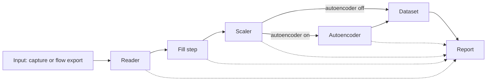
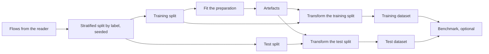

# Architecture

This page explains how NetGen is built and why. It is for reviewers and contributors. Terms follow [CONTEXT.md](../CONTEXT.md). Commands, options, exit codes and file shapes are in [usage.md](usage.md).

## The stages

A reader turns the input into flows. Three learning stages then prepare the flows. The preparation order is fixed: the fill step, the scaler, then the optional autoencoder. Every command also writes a report of what it saw and did.

The dotted edges carry the counts and warnings that each reader and stage returns. The solid edge into the report carries the prepared table.

`fit` learns the three stages from the training flows and saves them as artefacts. `transform` loads the artefacts and runs the same stages on new flows. `build` does both in one command, with a split first.

The split happens before anything is fitted, so no stage learns from a test flow. The split is 80/20 per label value, with the run's seed. Flows without a label form one group of their own. A group of `n` flows sends `(n + 2) // 5` flows to the test split, and at least one flow when `n` is 2 or more. A build whose test split would be empty fails.

## Why flows and not packets

A packet is too fine-grained for a tabular dataset. One web request is hundreds of packets, and one packet says little about the conversation it belongs to. A flow summarises the whole conversation between two endpoints as one row of numeric features. A flow export already holds flows. A capture holds packets, and NetGen forms the flows from them. Both routes end in the same flow record, so every later stage works on one row shape.

## Why an autoencoder, and why it is optional

An autoencoder rebuilds its input through a narrow bottleneck. It learns what is typical of the flows it was fitted on. Two derived columns come from it:

- The anomaly score is the mean squared reconstruction error over the features. A high score means the flow looks unlike the flows the autoencoder was fitted on.
- The latent columns are the bottleneck values, a compressed summary of each flow. They are written only with `--latents`.

`--fit-on-label` restricts the training rows to one label, so the anomaly score measures distance from that class (for example normal traffic). The label picks rows only; it is never an input.

The stage is optional because the scaled features already make a usable dataset. The autoencoder adds a dependency on torch, which is the extra `netgen[autoencoder]`, and it adds training time. `--autoencoder` turns it on. Without it, the rest of NetGen runs without torch.

Design choices in `src/netgen/stages/autoencoder.py`:

- The input is the scaler's output, feature columns only. The output layer is linear, because standardised values are unbounded.
- Only `--latent-dim` and `--epochs` are exposed. The other hyperparameters are fixed and recorded in the manifest.
- The stage trains on every row of the training split, with no internal validation split and no best-state restore. Fewer than 256 training rows (one full batch) fails, and so does a non-finite loss.
- The seed covers the weights, the dropout and the batch order. Training runs on the CPU with deterministic algorithms. `--seed` is the one seed of the run, shared with the split.
- The saved weights are a plain state dict, read back with `weights_only=True`. There is no pickle.

## The scaling method

The scaler applies one method to every feature, learned from the training split only:

1. **Log step.** A feature that the flow record declares `log` takes `log1p` first. These are the heavy-tailed fields: counts, sizes, durations, gaps and rates. A few huge flows would otherwise dominate the scale. The ratio and the three protocol indicators are declared `linear` and skip the step. The declaration is made once in `src/netgen/record.py`. Nothing is detected from data and no option changes it.
2. **Z-score.** The feature is shifted by the training mean and divided by the training standard deviation (population, `ddof=0`), both computed after the log step. A single outlier does not squeeze the other values into a narrow range, as it would with a Min-Max scale.

`log1p` needs non-negative input. Readers turn negative values into missing values, and the fill step replaces them, so the scaler never sees a negative feature.

A **constant feature** has a training standard deviation below `1e-12`. It stays in the dataset and is written as 0. The report names it. At transform time the report also counts values that differ from the training constant.

**No value is clipped.** A value outside the training range passes through the formula unchanged, so an unusual flow stays visible. The report counts out-of-range values per column, against the training minimum and maximum taken after the log step.

`scaler.json` stores each feature's log flag with its statistics. Transform never consults the current flow record for scaling, so old artefacts keep scaling the same way.

A destination port promoted by `--dst-port-as-feature` is scaled linearly. This is crude, because port numbers are categories. [usage.md](usage.md) carries the user-facing warning.

## The capture reader

`src/netgen/readers/capture.py` reads pcap and pcapng with scapy. It is the only module that imports scapy. It handles IPv4 and IPv6 alike.

- **Protocols.** TCP, UDP and ICMP are kept; ICMPv6 counts as ICMP. Any other IP protocol is kept as `other`, with no ports. The outer transport layer decides the protocol, so an ICMP error that embeds a TCP header stays ICMP. A non-IP packet is dropped and counted.
- **Payload bytes.** The payload is the IP total length minus the IP header and the transport header. A bare ACK carries 0, and link-layer padding never counts.
- **Detection.** `sniff` reads the first four bytes and accepts both pcap byte orders, microsecond and nanosecond, and the pcapng section header.
- **Truncation.** The reader walks the record lengths before it reads, because scapy stops silently on a truncated capture. A truncated or corrupt capture is an input error.
- **Start time.** The start time is the first packet's time as a naive UTC timestamp. A start time past the range of a timestamp (after 2262) becomes a missing value, with one warning.

### Flow formation

`src/netgen/aggregation.py` forms the flows and computes the features. It is not a stage. It imports neither scapy nor any reader, so a future packet reader can reuse it.

- The **flow key** is bidirectional: both endpoints, each sorted into a fixed order, plus the protocol. A packet from either side lands in the same flow. ICMP and `other` packets are keyed on addresses alone.
- **Forward** is the direction of the first packet. The flow's source and destination fields are those of that packet.
- An RST closes the flow at once. A FIN closes it only after both sides have sent FIN, at the next ACK from the side that sent the first FIN. The closing packets of an ordinary close therefore join their flow.
- The **idle timeout** (default 120 seconds) ends a flow that stays silent. The **active timeout** (off by default) cuts a flow that lasts too long. The packet that arrives after a timeout starts a new flow with the same key; no packet is lost. Both are flow settings, and the manifest records them so that transform reuses them.
- Each packet belongs to exactly one flow. A flow with one packet has a duration of 0, and a rate over a zero duration is a missing value.

## The flow-export reader

`src/netgen/readers/flow_export.py` reads a CICFlowMeter CSV in the layout of the CIC-IDS2017 data. A flow export already holds flows, so the reader ignores the flow settings.

- **Detection.** `sniff` needs the distinctive CICFlowMeter header names. Any other CSV gets an error that names the two supported inputs.
- **Header.** Header names are stripped of spaces. A repeated name keeps its first copy, with a warning. A column that the flow record does not hold is dropped, with a warning.
- **Encoding.** The reader tries UTF-8 and falls back to cp1252. The report records the encoding used.
- **Units.** CICFlowMeter writes times in microseconds; the reader converts them to seconds. Byte values are taken as the file wrote them.
- **Missing values.** A negative, infinite or non-numeric number becomes a missing value. So does a rate over zero duration and a down/up ratio over zero forward packets.
- **Protocol and ports.** IANA protocol numbers map to `tcp`, `udp` and `icmp` (ICMPv6 counts as ICMP). Any other number maps to `other`. Ports are kept only for TCP and UDP.
- **Start time.** The timestamp is read day-first, with or without seconds, and stays naive in the file's own local time. A value that does not parse fails the read.
- **Label.** The column named by `--label-col` becomes `label`. Without that column the table has no label.

`src/netgen/readers/__init__.py` lists the readers explicitly and detects the format by asking each reader's `sniff` in order. `--input-format` names a reader and skips detection. A new reader is one new module plus one line in the list.

## The flow record and the column roles

`src/netgen/record.py` declares the flow record once. [ADR 0001](adr/0001-common-flow-record.md) records why the record is a common core and not the full CICFlowMeter set. Each field declares its name, type, unit, default role and scaling. A field enters the record only if both a capture and a flow export can fill it exactly. Times are seconds and sizes are payload bytes, except the header-byte features. The field table is in the module; [usage.md](usage.md) lists the dataset columns.

The record holds six identity fields, the label, 29 features and the derived columns. The label is present only when the input has labels.

Every column has one of four roles:

- **Identity** columns (addresses, ports, protocol name, start time) say which flow a row is. The dataset keeps them for tracing. The scaler and the autoencoder never read them. `--dst-port-as-feature` promotes `dst_port` to a feature.
- The **label** is carried through untouched, and never a feature.
- **Features** are the numeric fields that the stages learn from.
- **Derived** columns are computed by a fitted stage: `anomaly_score` and the latent columns. They are written as computed, never rescaled and never learned from.

The roles are declared once for the run and recorded in the manifest. Transform takes the roles from the manifest, whatever roles its input carries, so fit and transform agree.

`src/netgen/table.py` enforces the rules in one place. A `FlowTable` is a frozen pair of a DataFrame and its role map. A stage reads only `features()`. It returns a new table through `with_features` or `with_derived`, and never changes a table in place. Derived columns enter only through `with_derived`. `check_record` checks a table against the record: it runs on every reader's output and on every transform input.

## The learning-stage protocol

[ADR 0002](adr/0002-own-learning-stage-protocol.md) records why NetGen uses its own protocol and not a scikit-learn Pipeline. `src/netgen/stages/__init__.py` defines it:

- A stage module has `fit(table)`, which returns a frozen fitted object, and `load(directory, manifest)`, which reads saved state.
- A fitted object has `transform(table)`, which returns the table with its counts and warnings, and `save(directory)`. It has no `fit`, so a second fit cannot append to the first.
- A stage learns only from `table.features()`. The fill step and the scaler change only feature columns. The autoencoder adds derived columns.
- State is plain JSON, except the autoencoder's weights-only torch state.

The learning stages are:

- **Fill step** (`src/netgen/stages/fill.py`). It learns the median and the largest finite value of each feature. It replaces each missing value with the median and each infinite value with the largest finite value. A feature with no finite training value is filled with 0, becomes constant, and is named in a warning.
- **Scaler** (`src/netgen/stages/scaler.py`), as described above.
- **Autoencoder** (`src/netgen/stages/autoencoder.py`), as described above.

`src/netgen/preparation.py` fixes the order and does not let a caller change it, because another order can leak test rows into fitting. Each stage fits on the training table after the earlier stages have transformed it. `Artefacts.transform` refuses an input that lacks a column the artefacts need, and refuses an input whose feature columns differ from those in `scaler.json`. It keeps a label column and drops other unknown columns with a warning.

## The artefacts

One fit writes one artefacts folder:

- `manifest.json` records the column roles, the ordered feature list with each log flag, the label column, the input fingerprint (a SHA-256 of the input bytes), the seed, the flow settings, the autoencoder settings and the stages in order. `transform` refuses a `format_version` other than its own.
- `fill.json` and `scaler.json` hold what the fill step and the scaler learned.
- `autoencoder.pt` holds the network weights and exists only when the autoencoder ran.
- `report.json` holds the report of the fit. For `build`, it is the report of the training split.

The files are readable and safe to load: JSON, plus weights-only torch state. Report numbers are observations, not learned state, so they never enter the manifest. [usage.md](usage.md) gives the shape of each file.
